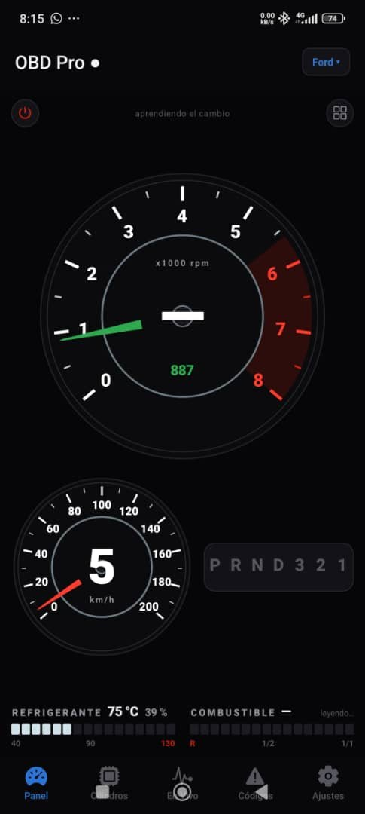
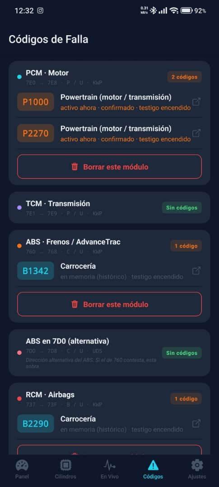
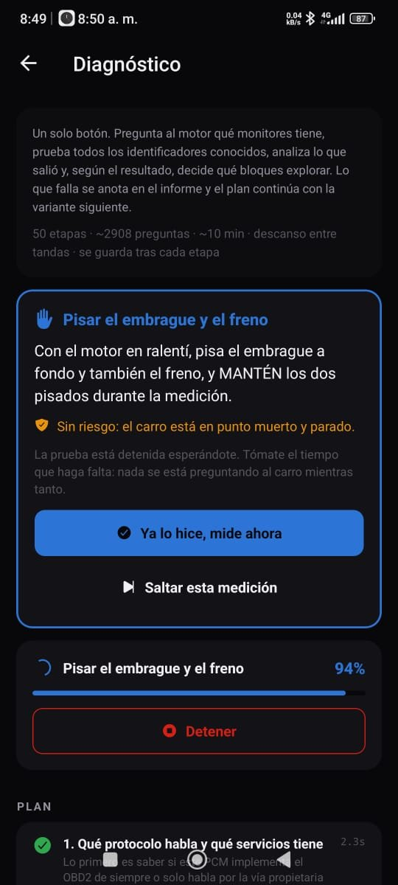
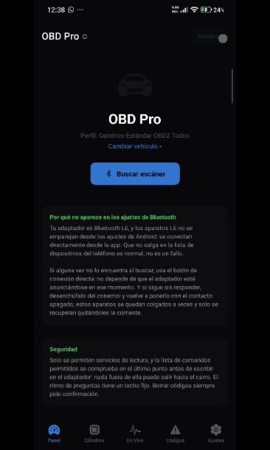
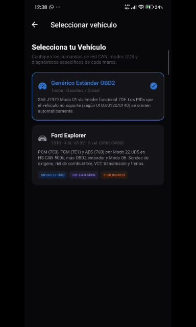
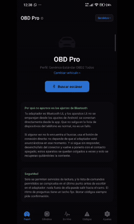

# 🚗 OBD Pro — Diagnóstico automotriz por Bluetooth

App móvil (Android) que se conecta a un adaptador **ELM327 Bluetooth LE** y convierte el teléfono en un escáner automotriz: lectura de sensores en tiempo real, códigos de avería explicados en español, balance por cilindro y un diagnóstico automático guiado que genera un informe completo.


---

## 📸 Capturas

<p align="center">
  
  
  
</p>
<p align="center">
  
  
  
</p>

<p align="center"><sub>Tablero en vivo · Códigos de falla por módulo (PCM, TCM, ABS, RCM) · Diagnóstico automático guiado · Panel · Perfiles de vehículo · Demo</sub></p>

---

## ✨ Funcionalidades

| Pantalla | Qué hace |
|---|---|
| **Portada / Cluster** | Tablero con tacómetro, anillos, luz de cambio y barra LED; muestra solo los datos que estás mirando para no saturar el bus. |
| **Datos en vivo** | Lectura continua de PIDs OBD-II (Modo 01) y PIDs extendidos del fabricante (Modo 22), con grabación y exportación de sesiones. |
| **Códigos (DTC)** | Lee, explica y borra códigos de avería. Cada código se explica en tres niveles: tabla propia en español → tabla opcional → familia deducida por su estructura (SAE J2012). |
| **Cilindros** | Balance de potencia y fallos de encendido por cilindro (Modo 06 / Modo 22), dibujados en el orden de encendido del motor. |
| **Diagnóstico automático** | Plan de pruebas guiado (motor frío/caliente, maniobras con el conductor) que termina en un informe listo para compartir. |
| **Prueba de caja** | Análisis del comportamiento de la transmisión. |
| **Ajustes / Seguridad** | *Modo estricto* que limita la app a comandos de solo lectura estándar. |

## 🧠 Aspectos técnicos destacados

- **Capa BLE propia** (`src/ble/BleManager.ts`) sobre `react-native-ble-plx`: escaneo por nombre de adaptador, selección automática de servicio/características (`FFE0` / `FFF0`), manejo de fragmentación de respuestas hasta el prompt `>`.
- **Gateway OBD con cola de comandos** (`src/obd/ObdGateway.ts`): un comando a la vez, timeouts adaptativos (`ATAT1`/`ATST`), rotación automática de protocolos (6 → 7 → 8 → 9 → 5 …) y cambio de cabecera (`ATSH`) para hablar con PCM, TCM y ABS.
- **Motor de sondeo** (`pollEngine.ts`) que solo consulta los PIDs visibles en pantalla para maximizar la frecuencia de refresco.
- **Capa de seguridad** (`safety.ts`): lista blanca de modos/servicios; bloquea comandos de escritura o reprogramación de la ECU (borrar DTC siempre pide confirmación).
- **Perfiles de vehículo** (`src/profiles/`): perfil genérico OBD-II + perfiles Ford (Explorer 2010 4.6 V8, EcoSport 2006 2.0) con PIDs Modo 22 descubiertos y **validados con mediciones reales** (p. ej. presión de riel real vs. deseada dentro del 1 %).
- **Estado global** con Zustand + persistencia en AsyncStorage.
- **Autopruebas** (`tools/selftest`) con un **simulador de ELM327** para probar la lógica sin carro ni adaptador.

## 🗂️ Estructura

```
app/                 Pantallas (expo-router)
  (tabs)/            Portada, datos en vivo, DTC, cilindros, ajustes
  diagnose.tsx       Diagnóstico automático
  caja.tsx           Prueba de transmisión
src/
  ble/               Conexión Bluetooth LE
  obd/               Protocolo ELM327, PIDs, DTC, diagnóstico, informes
  profiles/          Perfiles por vehículo
  store/             Estado global (Zustand) y persistencia
  ui/                Componentes gráficos (tacómetro, cluster, anillos…)
plugins/             Plugin de Expo para permisos BLE en Android
tools/selftest/      Autopruebas + simulador ELM327
```

## 🚀 Cómo ejecutarlo

Requisitos: Node 20+, Android con Bluetooth LE y un adaptador ELM327 BLE.

```bash
npm install
npx expo run:android      # build de desarrollo en un dispositivo conectado
npm run typecheck         # verificación de tipos
npm run selftest          # autopruebas con el simulador ELM327
```


> ⚠️ Herramienta de lectura/diagnóstico. Úsala con el vehículo detenido o con un acompañante; no reemplaza el criterio de un mecánico.

## 📦 Generar el APK para instalar en Android

No necesitas Android Studio: el APK se compila gratis en la nube con **EAS Build** de Expo.

```bash
npm install -g eas-cli        # una sola vez
eas login                     # cuenta gratis en expo.dev
eas build:configure           # solo la primera vez (vincula el proyecto a TU cuenta)
eas build -p android --profile preview
```

Al terminar (10-20 min) EAS muestra un **enlace y un código QR** para descargar el `.apk`; ábrelo en el teléfono e instálalo (permite "orígenes desconocidos").


| Opción | Comando | Resultado |
|---|---|---|
| APK para instalar directo | `eas build -p android --profile preview` | `.apk` |
| Publicar en Google Play | `eas build -p android --profile production` | `.aab` |
| Compilar en tu PC (requiere Android Studio) | `npx expo run:android --variant release` | `.apk` local |

> OBD Pro usa Bluetooth LE nativo (`react-native-ble-plx`), así que **no funciona en Expo Go**: hay que instalar el APK.

## Autor

**Dominic De Freitas** — Ingeniero en Informática (UGMA). Desarrollo aplicaciones móviles y web con React Native, TypeScript, Node.js y Python, y busco mi primer puesto como desarrollador junior remoto.

[Perfil de GitHub](https://github.com/dominic0285) · [LinkedIn](https://www.linkedin.com/in/dominic-de-freitas-07102828a/) · dominicdefreitasfd@gmail.com

Licencia [MIT](LICENSE).
